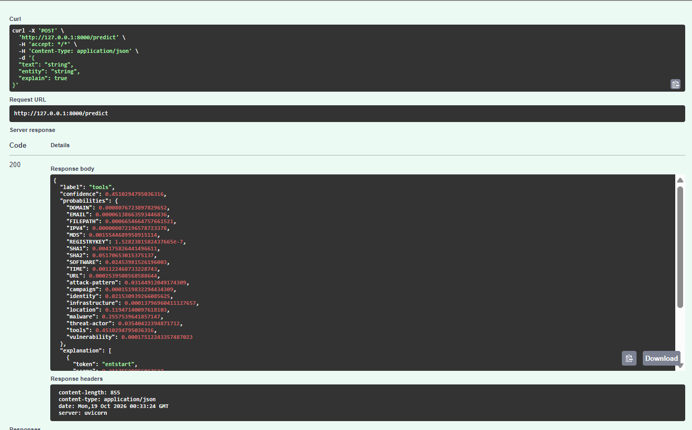
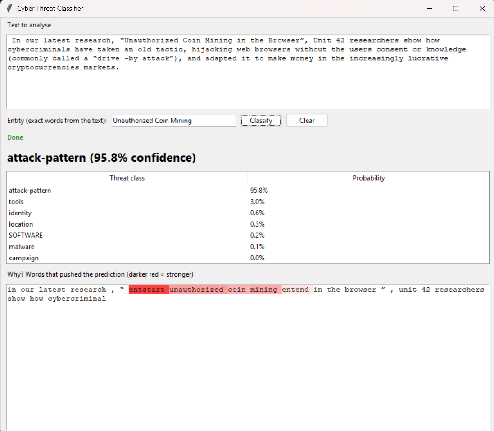

# Cyber Threat Entity Classifier (ITRI625)

A PyTorch BiLSTM that reads a sentence from a cyber-threat report plus a highlighted entity and predicts the entity's threat category (20 classes such as `malware`, `threat-actor`, `attack-pattern`, `identity`, `location`, `IPV4`, `SHA2`). The model is exposed through a FastAPI service and used by a Tkinter desktop app.

**Author:** Philani Kubeka (35048506) | **Module:** ITRI625 | **Dataset:** [Cyber Threat Dataset: Network, Text & Relation](https://www.kaggle.com/datasets/ramoliyafenil/text-based-cyber-threat-detection) (Kaggle, Ramoliya Fenil)

## Results (test set, 1,609 entity rows)

| Model | Accuracy | Macro precision | Macro recall | Macro F1 | Macro AUC-ROC |
|---|---|---|---|---|---|
| **BiLSTM (this project)** | 0.707 | 0.673 | 0.752 | **0.691** | **0.970** |
| TF-IDF + logistic regression (baseline) | 0.701 | 0.629 | 0.656 | 0.625 | 0.955 |

Early stopping (patience 7 on validation macro-F1) stopped training at epoch 19 and restored the best epoch (12). Strongest classes: IPV4, FILEPATH, URL, attack-pattern, TIME. Weakest: MD5, SHA1, tools (see the error analysis in the notebook). Full metrics, graphs and discussion are in the notebook.

## Repository layout

```
notebooks/CyberThreatClassification.ipynb   all model code, metrics, graphs, XAI, error analysis
api/inference.py                            preprocessing + model class + predictor (copy of the notebook model)
api/main.py                                 FastAPI service (/health, /info, /predict)
gui/app.py                                  Tkinter desktop client (calls the API)
artifacts/model.pt, preprocess.json         exported trained model and preprocessing settings
outputs/                                    metrics_log.csv, tuning_results.csv, figures/
docs/                                       report, slides, screenshots
data/raw/                                   dataset files (not committed, see below)
requirements.txt
```

## Setup

Requires Python 3.10 to 3.12 (3.13 also worked for development).

```bash
python -m venv .venv
source .venv/Scripts/activate        # Git Bash on Windows (Linux/macOS/WSL: source .venv/bin/activate)
python -m pip install --upgrade pip
python -m pip install -r requirements.txt
python -m ipykernel install --user --name itri625 --display-name "ITRI625"
```

**Dataset.** Download it from the Kaggle link above and put `all.jsonl` in `data/raw/` (the raw data is not committed). The notebook uses only `all.jsonl`.

## Run the notebook

Open `notebooks/CyberThreatClassification.ipynb`, choose the *ITRI625* kernel and run all cells (about 20 minutes on CPU). The hyper-parameter search (about 2 hours) is switched off by default (`RUN_TUNING = False`) and its saved results are loaded from `outputs/tuning_results.csv`. The run exports `artifacts/model.pt` and `artifacts/preprocess.json`.

## Run the API and desktop app

Use two terminals, both with the virtual environment active.

```bash
# Terminal 1 - API
cd api
python -m uvicorn main:app --port 8000
# open http://127.0.0.1:8000/docs for the interactive API page

# Terminal 2 - desktop app (from the repository root)
python gui/app.py
```

In the app, paste a sentence, type the entity words exactly as they appear in the sentence, and click **Classify**. It shows the predicted class, the probability of every class and a word-level explanation (darker red = more influence on the prediction). To use a different API address set `API_URL` (for example `export API_URL=http://127.0.0.1:8001`).

On Linux, Tkinter needs `sudo apt install python3-tk`.




## Method in brief

- **Task:** entity-level classification. Each row is one annotated entity; the input is 60 characters of context on each side of the entity with `entstart`/`entend` markers around it.
- **Cleaning and split:** 1,301 exact duplicates and 70 conflicting-label rows removed; stratified, group-aware split by source text (8,065 / 1,634 / 1,609) with leakage checks.
- **Model:** embedding (128) -> 2-layer bidirectional LSTM (128 per direction, dropout 0.4, packed sequences) -> max + mean pooling -> dense 128 + ReLU -> 20 logits; class-weighted cross-entropy, Adam, gradient clipping, ReduceLROnPlateau (1,537,812 parameters).
- **Logging:** loss, accuracy, macro precision, recall, F1 and one-vs-rest macro AUC-ROC for train and validation after every epoch (`outputs/metrics_log.csv`).
- **Graphs:** loss and metric curves, confusion matrix, ROC and precision-recall curves, per-class bars.
- **Extras:** TF-IDF baseline, hyper-parameter search table, occlusion-based explanations (XAI), error analysis.

## Limitations

Single dataset and no time-based split (concept drift untested); several classes have very few test examples; some labels look ambiguous; hash types (MD5, SHA1) are confused with SHA2; the API has no authentication or rate limiting.

## References and licence

Dataset: Ramoliya, F., *Cyber Threat Dataset: Network, Text & Relation*, Kaggle (check the licence on the dataset page before redistributing any data).
